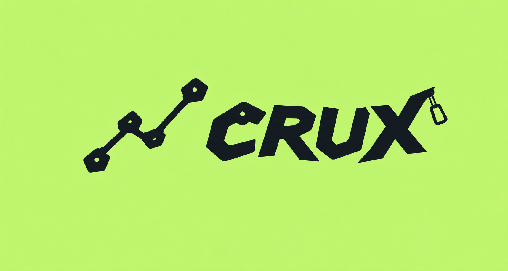
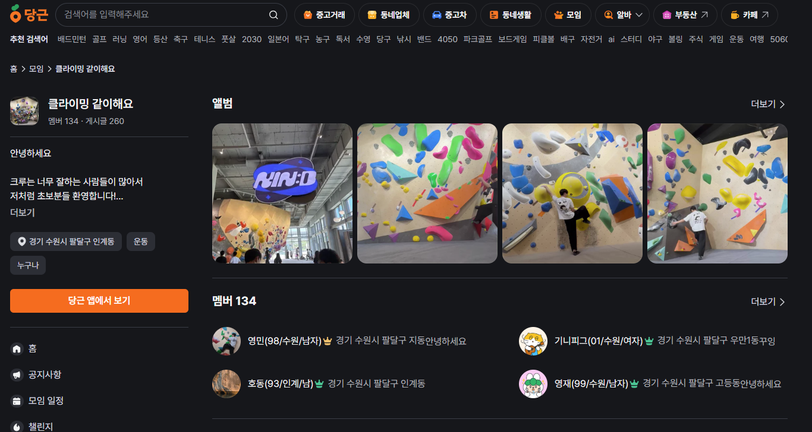

# CRUX — 나의 한계를 넘는 순간

> 한계를 마주하고, 도전하며, 함께 성장하는 순간

&nbsp;

CRUX는 클라이머를 위한 소셜 클라이밍 플랫폼 입니다.

나의 도전을 기록하고, 새로운 사람들과 함께하며, 더 높은 목표를 향해 나아가는 공간입니다.

&nbsp;

## 🌱 The Beginning

> **모임을 운영하는 한 클라이머의 작은 고민에서 시작되었습니다.**

&nbsp;

저는 당근 모임에서 직접 클라이밍 모임을 5개월간 운영하며 느꼈던 경험들이 CRUX의 시작이 되었습니다.

함께할 사람을 찾고, 일정을 조율하고, 새로운 암장을 발견하고, 서로의 등반을 공유하는 과정.

_이 모든 경험을 조금 더 쉽고 자연스럽게 연결할 수는 없을까?_

단순히 함께 운동하는 것을 넘어, 새로운 인연을 만들고 서로의 성장을 응원하며 끊임없이 도전할 수 있는 공간.

**CRUX는 클라이밍을 사랑하는 사람들이 더 자유롭게 연결되고, 함께 성장할 수 있도록 시작되었습니다.**

&nbsp;

## ✨ 주요 기능

- **Community** — 등반 경험과 순간을 공유하고, 클라이머들과 소통하세요.
- **My Records** — 나의 등반 기록과 성장을 확인하고, 새로운 목표에 도전하세요.
- **Ranking** — 참여 횟수와 완등 기록으로 다른 클라이머들과 경쟁하고 성취를 나누세요.
- **Meetup** — 직접 모임을 만들고, 함께 도전할 클라이밍 파트너를 만나보세요.
